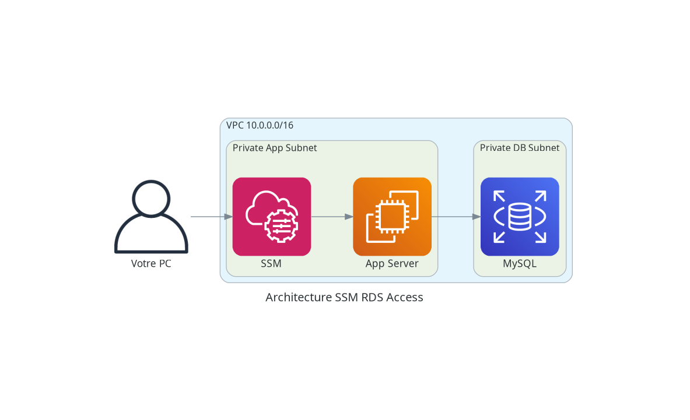
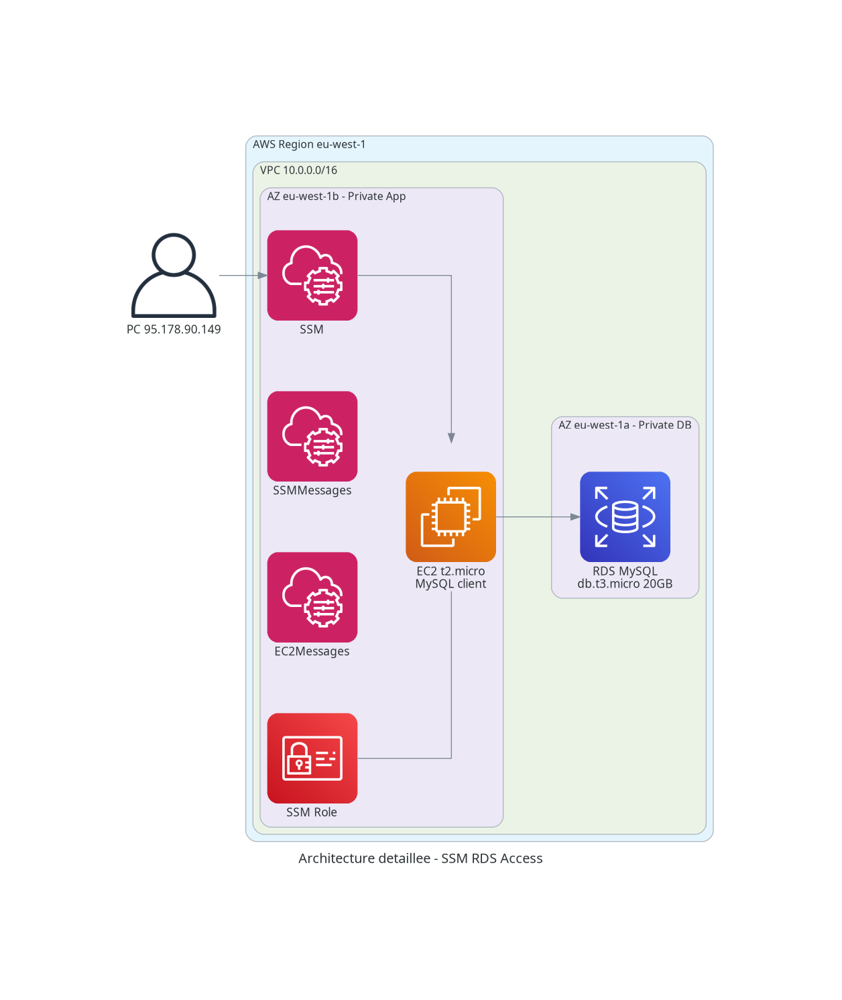

# Test d'accès à une base de données privée depuis Internet

## Architecture

Ce projet Terraform déploie une infrastructure AWS pour tester l'accès à une base de données sur un subnet privé depuis Internet.

### Diagrammes

**Diagramme simple :**



**Diagramme détaillé :**



**Diagramme ASCII complet :** Voir [architecture-diagram.md](architecture-diagram.md)

**Diagramme Draw.io éditable :** Voir [architecture.drawio](architecture.drawio)

### Composants

- **VPC** : 10.0.0.0/16
- **1 Subnet Public** : 10.0.1.0/24 (pour bastion/jump host)
- **1 Subnet Privé DB** : 10.0.10.0/24 (pour la base de données)
- **1 Subnet Privé App** : 10.0.11.0/24 (pour les applications backend)
- **Internet Gateway** : Pour l'accès Internet au subnet public
- **EC2 App Server** : Instance t2.micro dans le subnet App (free tier)
- **RDS MySQL** : Instance db.t3.micro dans le subnet DB (free tier)
- **Security Groups** :
  - Bastion : SSH (port 22) depuis Internet
  - App : SSH depuis le bastion
  - Database : MySQL (3306) depuis le bastion et l'app server

### Free Tier

**Ressources déployées (Free Tier) :**
- VPC, Subnets, Route Tables, Internet Gateway : Gratuit
- Security Groups : Gratuit
- EC2 App Server (t2.micro) : 750 heures/mois gratuit
- RDS MySQL (db.t3.micro, 20GB) : 750 heures/mois gratuit
- VPC Endpoints (SSM) : ~$0.01/heure (~$7/mois) - nécessaire pour SSM sans NAT Gateway

**Non déployé (coûte de l'argent) :**
- NAT Gateway : ~$0.045/heure + data transfer (commenté par défaut)
- Bastion Host : Optionnel

## Utilisation

### Prérequis

1. **Générer une paire de clés SSH** :

**Linux :**
```bash
ssh-keygen -t rsa -b 4096 -f ~/.ssh/db-access-test
cat ~/.ssh/db-access-test.pub
```

**Mac :**
```bash
ssh-keygen -t rsa -b 4096 -f ~/.ssh/db-access-test
cat ~/.ssh/db-access-test.pub
```

**Windows PowerShell :**
```powershell
ssh-keygen -t rsa -b 4096 -f $env:USERPROFILE\.ssh\db-access-test
Get-Content $env:USERPROFILE\.ssh\db-access-test.pub
```

2. **Configurer les variables** :
```bash
cp terraform.tfvars.example terraform.tfvars
# Éditer terraform.tfvars avec votre clé publique et mot de passe DB
```

### Déploiement

```bash
terraform init
terraform plan
terraform apply
```

### Accès à la base de données depuis votre PC

**📖 Voir le guide complet : [ACCESS_GUIDE.md](ACCESS_GUIDE.md)**

Le guide inclut les instructions pour **Linux, Mac et Windows**.

**Résumé rapide (Linux) :**

```bash
# 1. Créer le tunnel SSM
APP_INSTANCE_ID=$(terraform output -raw app_instance_id)
RDS_ENDPOINT=$(terraform output -raw rds_address)

aws ssm start-session \
  --target $APP_INSTANCE_ID \
  --document-name AWS-StartPortForwardingSessionToRemoteHost \
  --parameters "{\"host\":[\"$RDS_ENDPOINT\"],\"portNumber\":[\"3306\"],\"localPortNumber\":[\"3306\"]}" \
  --profile galiceau-labs

# 2. Dans un autre terminal
mysql -h 127.0.0.1 -P 3306 -u admin -p
```

**Résumé rapide (Mac) :**

```bash
# 1. Créer le tunnel SSM
APP_INSTANCE_ID=$(terraform output -raw app_instance_id)
RDS_ENDPOINT=$(terraform output -raw rds_address)

aws ssm start-session \
  --target $APP_INSTANCE_ID \
  --document-name AWS-StartPortForwardingSessionToRemoteHost \
  --parameters "{\"host\":[\"$RDS_ENDPOINT\"],\"portNumber\":[\"3306\"],\"localPortNumber\":[\"3306\"]}" \
  --profile galiceau-labs

# 2. Dans un autre terminal
mysql -h 127.0.0.1 -P 3306 -u admin -p
```

**Résumé rapide (Windows PowerShell) :**

```powershell
# 1. Créer le tunnel SSM
$APP_INSTANCE_ID = terraform output -raw app_instance_id
$RDS_ENDPOINT = terraform output -raw rds_address

aws ssm start-session `
  --target $APP_INSTANCE_ID `
  --document-name AWS-StartPortForwardingSessionToRemoteHost `
  --parameters "{`"host`":[`"$RDS_ENDPOINT`"],`"portNumber`":[`"3306`"],`"localPortNumber`":[`"3306`"]}" `
  --profile galiceau-labs

# 2. Dans une autre fenêtre
mysql -h 127.0.0.1 -P 3306 -u admin -p
```

✅ Aucune exposition publique  
✅ Pas de bastion nécessaire  
✅ Gratuit et sécurisé  
✅ Fonctionne sur Linux, Mac et Windows

### Destruction

```bash
terraform destroy
```

## Architecture déployée

L'infrastructure déploie :
- Une instance EC2 (t2.micro) dans le subnet App privé avec IAM role SSM
- Une base de données RDS MySQL (db.t3.micro) dans le subnet DB privé
- VPC Endpoints pour AWS Systems Manager (SSM, SSMMessages, EC2Messages)
- Security groups configurés pour permettre la communication

### Accès sécurisé à la base de données

**Solution déployée : AWS Systems Manager Session Manager + Port Forwarding**

Cette solution permet d'accéder à votre DB depuis votre PC **sans exposer quoi que ce soit publiquement** :
- ✅ Pas de bastion nécessaire
- ✅ Pas d'IP publique sur l'EC2
- ✅ Pas d'exposition de la DB
- ✅ Tunnel sécurisé via AWS SSM
- ✅ Audit complet dans CloudTrail

Voir [ACCESS_GUIDE.md](ACCESS_GUIDE.md) pour les instructions détaillées.

## Notes

- Le NAT Gateway est commenté par défaut car il n'est pas gratuit (~$0.045/heure)
- L'accès sécurisé se fait via AWS Systems Manager Session Manager (pas besoin de NAT Gateway)
- Les subnets privés n'ont pas d'accès Internet sortant (sécurité renforcée)
- Les VPC Endpoints permettent à l'EC2 de communiquer avec AWS SSM sans Internet

## Sécurité

L'infrastructure implémente plusieurs couches de sécurité :
1. **IAM/SSO** : Seul votre profil AWS peut utiliser SSM
2. **VPC privé** : EC2 et DB sans accès Internet direct
3. **Security Groups** : Contrôle strict du trafic réseau
4. **VPC Endpoints** : Communication sécurisée avec AWS SSM
5. **CloudTrail** : Audit de toutes les connexions
